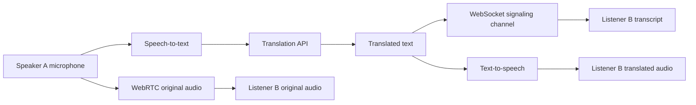

# BhashaCall AI

> **A browser-based voice-call prototype that helps two people speaking different languages communicate through translated speech.** The initial language pair is Hindi and English.

**Project Status:** Functional Prototype — Under Active Development

**Current Scope:** Real-time interaction between two participants per room, with a roadmap for multi-user support.

**Frontend:** HTML5, CSS3, JavaScript ES Modules, responsive UI.

**Backend:** FastAPI (Python), and WebSocket-based real-time communication.

**Core Focus:** Real-time collaboration, user-friendly experience, and responsible AI usage.

**Current Limitations:** Limited to two participants per room; authentication, scalability, error handling, and production deployment are under development.
---

## Table of Contents

- [Problem Statement](#problem-statement)
- [Our Solution](#our-solution)
- [How It Works](#how-it-works)
- [How Gemini Is Used](#how-gemini-is-used)
- [Technology Stack](#technology-stack)
- [Project Structure](#project-structure)
- [Getting Started](#getting-started)
- [Environment Configuration](#environment-configuration)
- [Running the Application](#running-the-application)
- [Testing a Call](#testing-a-call)
- [Running Tests](#running-tests)
- [Limitations](#limitations)
- [Privacy and Security](#privacy-and-security)
- [Team Members](#team-members)
- [Work Completed Before the Event](#work-completed-before-the-event)
- [Work on Event Day](#work-on-event-day)
- [Credits and Acknowledgements](#credits-and-acknowledgements)

---

## Problem Statement

Language barriers can make voice conversations difficult when two people do not speak the same language. Traditional translation tools often require users to stop a conversation, open another app, and manually enter or speak each sentence. This interrupts the natural flow of communication.

## Our Solution

**BhashaBridge AI** is a multilingual voice-call prototype designed to make cross-language conversations easier. Two users join a browser-based call. Each person can choose the language they speak and the language in which they want to hear the other participant.

For example, a Hindi speaker can speak naturally while an English-speaking participant receives an English translation as spoken audio. The initial prototype focuses on Hindi ↔ English and combines WebRTC calling with speech recognition, translation, and text-to-speech.

The prototype is intended for demonstration and experimentation. It does not promise zero latency, perfect translation, or end-to-end encryption of the translation pipeline.

## How It Works

The audio and translation pipeline works as follows:

1. **Capture speech:** The speaker's browser captures microphone audio.
2. **Speech-to-text (STT):** The spoken words are transcribed using a configured provider or the browser's Web Speech API.
3. **Translation:** The transcript is translated from the speaker's language into the listener's selected language.
4. **Text-to-speech (TTS):** The translated text is spoken aloud on the listener's device.
5. **Original audio:** WebRTC also carries the original voice. The listener can adjust its volume or reduce it while listening to translated speech.

The original WebRTC audio and translated speech use separate playback paths. The translated audio is not mixed into the WebRTC stream.

### Architecture at a glance



WebSocket signaling relays WebRTC setup messages and small application messages. WebRTC carries the original audio between browsers.

## How Gemini Is Used

Google Gemini can power the three main language-processing stages when `GEMINI_API_KEY` is configured:

- **Speech-to-text:** Converts microphone audio into text.
- **Translation:** Translates the transcript into the listener's selected language.
- **Text-to-speech:** Generates spoken audio from the translated text.

With the default automatic provider selection, a configured Gemini API key takes priority for STT, translation, and TTS. The backend sends provider requests, keeping API keys on the server rather than exposing them in frontend code.

Gemini model names can change over time, so the model settings can be overridden in the `.env` file. Live Gemini calls and real microphone/browser calls must be tested in the target environment; mocked HTTP tests alone do not establish that live integration works.

**Demo mode without API keys:** Translation uses a small fixed phrasebook and is **simulated, not AI translation**. Only supported phrases are translated. The interface marks these results as `SIMULATED`. Browser speech recognition and speech synthesis may be used where supported.

## Technology Stack

| Component | Technology |
|---|---|
| Frontend | HTML, CSS, JavaScript ES modules |
| Backend | Python 3.10+, FastAPI, Uvicorn |
| Real-time voice | WebRTC |
| Signaling and transcript messages | WebSocket |
| Speech recognition | Gemini, OpenAI, Mistral Voxtral (optional), or browser Web Speech API |
| Translation | Gemini, Mistral, OpenAI, Google Cloud Translation, or demo phrasebook |
| Text-to-speech | Gemini, OpenAI, or browser `speechSynthesis` |
| Configuration | Environment variables in `.env` |
| Tests | pytest |

No Node.js, `package.json`, Vite, or separate frontend development server is required.

## Project Structure

```text
bhashabridge-ai/
├── backend/
│   └── app/
│       ├── main.py             # FastAPI application, REST and WebSocket routes
│       ├── config.py           # Environment and provider configuration
│       ├── languages.py        # Supported languages
│       ├── signaling.py        # Two-person room management
│       ├── ratelimit.py        # Basic per-IP rate limiting
│       └── providers/
│           ├── stt.py          # Speech-to-text providers
│           ├── translate.py    # Translation providers
│           ├── tts.py          # Text-to-speech providers
│           └── errors.py       # Provider error handling
├── frontend/
│   ├── index.html
│   ├── css/
│   │   └── styles.css
│   └── js/
│       ├── main.js
│       ├── call.js             # WebRTC call logic
│       ├── speech.js           # Speech recognition and playback
│       └── api.js              # Backend API calls
├── tests/
├── .env.example
├── .gitignore
├── pytest.ini
├── requirements.txt
└── README.md
```

*Note: The exact test-directory location may vary with the repository layout.*

## Getting Started

### Prerequisites

- Python 3.10 or newer
- Google Chrome or Microsoft Edge recommended
- Internet connection for online speech recognition and hosted AI providers
- Microphone access
- Optional API key(s) for real AI-powered speech recognition, translation, and speech generation

### 1. Clone or open the project

If the project is hosted in a Git repository:

```powershell
git clone <REPOSITORY_URL>
cd bhashabridge-ai
```

If you already have the project files, open PowerShell in the project root (`bhashabridge-ai`).

### 2. Create and activate a virtual environment

```powershell
py --version
py -m venv .venv
.\.venv\Scripts\Activate.ps1
```

If PowerShell blocks activation scripts, run the following in the current PowerShell session and try activation again:

```powershell
Set-ExecutionPolicy -Scope Process -ExecutionPolicy Bypass
.\.venv\Scripts\Activate.ps1
```

### 3. Install dependencies

```powershell
pip install -r requirements.txt
```

### 4. Create the environment file

```powershell
Copy-Item .env.example .env
```

Edit `.env` and add the provider settings you want to use. Do not commit `.env` or expose API keys in frontend code.

## Environment Configuration

### Recommended Gemini configuration

Add your Gemini API key to `.env`:

```dotenv
GEMINI_API_KEY=your_gemini_api_key_here
```

Then restart the server. With automatic provider selection, the application should select Gemini for speech-to-text, translation, and text-to-speech when the key and configured models are valid.

Optional Gemini settings may include:

```dotenv
GEMINI_STT_MODEL=your_supported_stt_model
GEMINI_TRANSLATE_MODEL=your_supported_translation_model
GEMINI_TTS_MODEL=your_supported_tts_model
GEMINI_TTS_VOICE=Kore
```

Use model identifiers supported by the provider and by this project's implementation. Check the provider's current documentation before changing model names.

### Alternative provider settings

The application can be configured to use other providers, depending on the implementation and available keys:

```dotenv
# Example: browser speech recognition + Mistral translation + browser speech
STT_PROVIDER=browser
TRANSLATE_PROVIDER=mistral
TTS_PROVIDER=browser
MISTRAL_API_KEY=your_mistral_api_key_here
```

Other supported configuration options may include `OPENAI_API_KEY`, `GOOGLE_TRANSLATE_API_KEY`, `STUN_SERVER_URL`, `TURN_SERVER_URL`, `TURN_USERNAME`, `TURN_CREDENTIAL`, and `ALLOWED_ORIGINS`. Refer to `.env.example` and `backend/app/config.py` for the exact supported variables and defaults.

**Important:** Hosted AI APIs may charge for usage and may impose quotas or rate limits. Check each provider's current pricing and your account's usage dashboard. Browser speech recognition can also use an online service and should not automatically be assumed to be fully offline.

## Running the Application

From the project root, with the virtual environment activated, run:

```powershell
uvicorn backend.app.main:app --host 127.0.0.1 --port 8000 --reload
```

Open the following URL in Chrome or Edge:

```text
http://localhost:8000
```

FastAPI serves the frontend and API, so only one local server is needed.

## Testing a Call

### Test with two browser tabs

1. Open `http://localhost:8000` in the first tab.
2. Enter a display name, set **I speak** to Hindi, and set **I want to hear** to English.
3. Create a call and allow microphone access.
4. Copy the invite link or room code.
5. Open the invite link in another tab or an Incognito window.
6. Set the second participant's **I speak** language to English and **I want to hear** language to Hindi, then join the room.
7. Confirm both participants show a connected status.
8. Speak a short phrase and check the transcript and translated speech.

Try phrases such as “नमस्ते”, “धन्यवाद”, “आप कैसे हैं”, “hello”, “thank you”, and “how are you”. In demo mode, only phrases present in the phrasebook will be translated.

**Use headphones** to reduce acoustic echo when testing with two tabs on the same computer.

### Test with two devices

Microphone access generally requires a secure context: `localhost` or HTTPS. To test on a phone and laptop, use a suitable HTTPS tunnel or configure a secure deployment. Binding the server to `0.0.0.0` alone does not make an HTTP LAN address a secure context.

## Running Tests

With the virtual environment activated:

```powershell
pytest
```

The automated tests cover implemented backend areas such as health/configuration, provider selection, demo translation, validation, room management, and rate limiting. Automated tests do **not** replace manual testing of live provider APIs, real microphones, or a two-browser WebRTC call.

## Limitations

- **Prototype only:** Not designed or audited for production use.
- **Latency:** The pipeline runs sequentially (STT → translation → TTS), so translated speech can arrive several seconds after a sentence. Some modes also wait for a pause in speech.
- **Translation quality:** Translations can be inaccurate, especially with accents, background noise, names, or context-dependent language.
- **Demo phrasebook:** Without a real translation provider, only a limited set of fixed phrases works. Results are marked `SIMULATED`; this is not AI translation.
- **Browser compatibility:** Browser speech recognition is best supported in Chrome and Edge and may depend on an online service.
- **Language voices:** Browser TTS depends on voices installed on the user's device.
- **Room size:** A room supports two participants.
- **Network traversal:** Some networks and firewalls require a TURN server; STUN alone may not be enough.
- **Testing status:** Live API integrations and the complete real-microphone/WebRTC experience require manual validation in the intended environment.
- **No zero-latency claim:** Processing and network delays are expected.

## Privacy and Security

- The app requires microphone permission to capture speech.
- Depending on configuration, audio or transcript text may be sent to third-party providers such as Google, OpenAI, Mistral, or a browser speech service.
- The intended backend behavior is not to store call audio or transcript text; logs are designed to contain metadata rather than transcript content. Verify this behavior in the current code and deployment before relying on it.
- WebRTC encrypts its media transport using DTLS-SRTP when correctly negotiated.
- Translated text passes through the application server/signaling path. Therefore, do **not** describe the entire translation process as end-to-end encrypted or fully private.
- The prototype includes basic validation, message-size limits, and per-IP rate limiting, but does not implement user authentication. Anyone who obtains a valid room link/code may be able to attempt to join.
- Keep all API keys in server-side environment variables. Never commit `.env` to source control.

Do not use this prototype for sensitive or confidential conversations without a thorough security, privacy, and deployment review.

## Team Members

Add the actual contributors below before submitting or presenting the project.

| Name | Role / Contribution |
|---|---|
| `Shrey Mishra` | `Team Leader /Over All Management` |
| `Yogesh Kumar Yadav` | ` Frontend and user interface` |
| `Dagendra Kumar Sahu` | ` Backend, WebRTC and call flow` |
| `Nomend Kumar Sahu` | `Researcher and demo` |

*Replace the placeholders with the real names and contributions. Remove unused rows.*

## Work Completed Before the Event

Update this section to reflect only work actually completed before the event. Possible items, if applicable:

- Defined the language-barrier problem and the initial Hindi–English use case.
- Planned the STT → translation → TTS processing pipeline.
- Set up the FastAPI backend and browser-based frontend structure.
- Implemented or prepared WebRTC signaling and two-person room management.
- Added configurable provider selection and environment-based API-key handling.
- Prepared a demo phrasebook for testing without paid AI API calls.
- Added basic validation, rate limiting, and automated backend tests.
- Documented setup instructions, known limitations, and privacy considerations.

## Work on Event Day

Record what the team actually built, tested, or demonstrated during the event. For example, if completed:

- Configured the development environment and launched the FastAPI server.
- Connected two browser sessions and tested the call flow.
- Tested microphone permissions, original-audio playback, transcripts, and language selection.
- Configured Gemini or another provider and tested available STT, translation, and TTS features.
- Demonstrated Hindi-to-English and English-to-Hindi conversation scenarios.
- Investigated issues such as provider quotas, latency, browser voice availability, or network connectivity.
- Presented the prototype, collected feedback, and identified next steps.

*Edit these bullets to match the work completed on the event day; do not list planned or unverified work as finished.*

## Credits and Acknowledgements

- **Google Gemini:** Optional AI provider for speech-to-text, translation, and text-to-speech, when configured and supported by the implementation.
- **FastAPI:** Python web framework for the backend and API endpoints.
- **WebRTC:** Browser-to-browser real-time media communication.
- **Web Speech API:** Browser-provided speech recognition and speech synthesis where supported.
- **Open-source Python packages:** See `requirements.txt` for dependencies and their licenses.

Thanks to the event organizers, mentors, testers, and everyone who provided feedback. Add any required event-specific acknowledgements, datasets, assets, or third-party references here.

---

## Future Improvements

- Reduce latency through streaming or more incremental speech processing.
- Improve transcription and translation quality in noisy environments.
- Add more languages and validate language-specific speech voices.
- Add authentication, stronger room access controls, and production-grade privacy/security reviews.
- Improve network reliability with TURN configuration and broader device testing.
- Add clear consent and provider-data handling information before calls begin.

---

**Disclaimer:** BhashaBridge AI is a prototype for demonstration and learning. Provider availability, supported models, pricing, and browser behavior may change. Verify the current configuration and test the complete call flow before presenting the project as fully functional.
