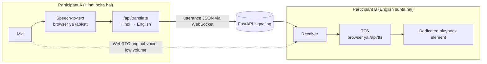

# BhashaBridge AI — Multilingual Voice Call (Prototype)

Do browser users ke beech WebRTC voice call, jisme ek bande ki speech **transcribe → translate → text-to-speech** hoke dusre bande ko uski language me sunai deti hai. Pehli languages: **Hindi** aur **English**.

> ⚠️ **Ye prototype hai, production system nahi.** Pipeline sequential hai (STT → translation → TTS), isliye har sentence ke baad **kuch seconds ka delay** aayega. Translation perfect nahi hota. "Zero latency" ya "end-to-end encrypted translation" ka koi claim nahi hai.

---

## 1. Architecture (short)

- **Frontend:** plain HTML/CSS/JS (ES modules), koi build step nahi. FastAPI hi isse serve karta hai, to **sirf ek server** chalana hai (`localhost:8000`).
- **Backend:** FastAPI — WebSocket signaling (`/ws/{room}`), aur REST APIs: `/api/config`, `/api/rooms`, `/api/translate`, `/api/stt`, `/api/tts`.
- **Call:** WebRTC (browser-to-browser audio). Signaling sirf offer/answer/ICE aur chhote JSON messages relay karti hai.
- **Providers (configurable, `.env` se):**

| Kaam | Keys ke bina (free) | Key ke saath |
|---|---|---|
| Speech-to-text | Browser Web Speech API (sirf Chrome/Edge) | **Google Gemini**, OpenAI transcription, ya Mistral Voxtral (`STT_PROVIDER=mistral`) |
| Translation | **DEMO phrasebook (SIMULATED, AI nahi)** — sirf kuch fixed phrases | **Google Gemini**, Mistral, OpenAI ya Google Translate |
| Text-to-speech | Browser `speechSynthesis` (device me Hindi voice honi chahiye) | **Google Gemini TTS**, ya OpenAI TTS (Mistral TTS abhi implement nahi hai) |

### "Output" ka default: Original voice
Har participant ke paas "I want to hear" me ek option hai: **Original voice — as spoken (default)**. Ye default hai. Iska matlab: samne wala jaisa bol raha hai, waisi hi original awaaz full volume me sunai deti hai, koi translation nahi hota aur koi translation API call (cost) nahi lagti. Transcript phir bhi dikhta hai. Translation chahiye to Hindi ya English chuno. Tab original awaaz slider se kam ho jaati hai (default 10%; 0 karo to sirf translation sunai degi).

Demo mode me UI upar banner dikhata hai aur transcript me har line pe "SIMULATED" likha aata hai. Jo phrase phrasebook me nahi hai, wo bola nahi jata.

### Mermaid diagram



### Audio ka flow
1. A ka mic (echo cancellation ON) do jagah jaata hai: WebRTC ke through B ko **original awaaz**, aur local speech recognition ko.
2. Text milne par A ka browser server ko `/api/translate` call karta hai (A ki spoken language → B ki output language).
3. Original + translated text WebSocket se B ko jaata hai (transcript me dono dikhte hain).
4. B ka browser translated text ko TTS se bolta hai.

**Design choice:** translated awaaz WebRTC stream me mix **nahi** hoti. Wo ek alag **dedicated playback element** (`#ttsAudio` / `speechSynthesis`) me chalti hai. WebRTC wali original awaaz low volume (default 20%, slider se badal sakte ho) pe chalti hai, aur translation bolte waqt 0 ho jaati hai.

### Echo / loop kaise rokte hain
- Sirf **apna local mic** transcribe hota hai. Remote WebRTC audio aur TTS output kabhi STT me nahi jaate.
- Mic `echoCancellation`, `noiseSuppression`, `autoGainControl` ke saath khulta hai.
- Jab tak translated audio chal raha hota hai (aur uske 400 ms baad tak), local listening **band** rehti hai. Isse speaker ki awaaz dobara transcribe nahi hoti.
- Mute karne par listening bhi ruk jaati hai.
- **Limitation:** ek hi laptop pe do tabs test karoge to speaker ki awaaz mic me ja sakti hai. **Headphones lagao** ya alag devices use karo.

---

## 2. Project structure

```
bhashabridge-ai/
├── backend/
│   ├── app/
│   │   ├── main.py          # FastAPI app, REST + WebSocket routes
│   │   ├── config.py        # .env settings, provider selection
│   │   ├── languages.py     # supported languages (yahin nayi language add karo)
│   │   ├── signaling.py     # 2-person room manager
│   │   ├── ratelimit.py     # simple per-IP rate limit
│   │   └── providers/       # stt.py, translate.py, tts.py, errors.py
│   └── tests/               # pytest tests
├── frontend/
│   ├── index.html
│   ├── css/styles.css
│   └── js/                  # main.js, call.js (WebRTC), speech.js, api.js
├── .env.example
├── .gitignore
├── pytest.ini
├── requirements.txt
└── README.md
```

`package.json` nahi hai kyunki frontend me Node/Vite ki zaroorat nahi — project low-spec laptop pe halka chalta hai.

---

## 3. Setup (Windows PowerShell)

Python 3.10+ chahiye (`py --version` se check karo).

```powershell
cd bhashabridge-ai
py -m venv .venv
.\.venv\Scripts\Activate.ps1
pip install -r requirements.txt
Copy-Item .env.example .env
```

Agar `Activate.ps1` pe "running scripts is disabled" error aaye:

```powershell
Set-ExecutionPolicy -Scope Process -ExecutionPolicy Bypass
.\.venv\Scripts\Activate.ps1
```

### Server start karo

```powershell
uvicorn backend.app.main:app --host 127.0.0.1 --port 8000 --reload
```

Browser me kholo: **http://localhost:8000** (Chrome ya Edge best hai).

> Frontend alag server pe nahi chalta, FastAPI hi serve karta hai. Isliye "dono servers" ki jagah sirf ye ek command hai.

---

## 4. API keys configure karna (`.env`)

Keys **sirf backend** me rehti hain, frontend code me kabhi nahi aati. `.env` ko git me commit mat karna (`.gitignore` me already hai).

| Variable | Kab zaroori hai |
|---|---|
| `GEMINI_API_KEY` | **Gemini** ke liye (aistudio.google.com/apikey se key). Key set ho to `auto` me STT + translation + TTS teeno Gemini se hote hain |
| `GEMINI_STT_MODEL` / `GEMINI_TRANSLATE_MODEL` / `GEMINI_TTS_MODEL` / `GEMINI_TTS_VOICE` | Optional. Default: `gemini-3.5-flash` / `gemini-3.5-flash-lite` / `gemini-2.5-flash-preview-tts` / `Kore`. Model naam Google badalta rehta hai, to `.env` se badal sakte ho |
| `MISTRAL_API_KEY` | Translation ke liye Mistral (console.mistral.ai se key), ya `STT_PROVIDER=mistral` |
| `OPENAI_API_KEY` | Jab STT / translation / TTS me se koi `openai` ho (ya `auto` aur key set ho) |
| `GOOGLE_TRANSLATE_API_KEY` | Sirf jab `TRANSLATE_PROVIDER=google` ho. Ye plain API key hai (Cloud Translation v2). Service-account JSON support nahi hai |
| `STT_PROVIDER` / `TRANSLATE_PROVIDER` / `TTS_PROVIDER` | Optional. `auto` (default), warna explicitly choose karo |
| `STUN_SERVER_URL` | Default Google ka public STUN |
| `TURN_SERVER_URL`, `TURN_USERNAME`, `TURN_CREDENTIAL` | Optional, strict NAT/firewall ke liye |

**`auto` ka matlab:**
- Gemini key ho to STT, translation aur TTS teeno Gemini (sabse pehle check hota hai). Neeche wale rules tab lagte hain jab Gemini key na ho.
- STT: OpenAI key ho to OpenAI, warna browser. Mistral STT sirf tab chalta hai jab aap `STT_PROVIDER=mistral` likho.
- Translation: Mistral key > OpenAI key > Google key > demo phrasebook.
- TTS: OpenAI key ho to OpenAI, warna browser.

### Gemini setup (recommended)

```
GEMINI_API_KEY=AIza...
```
Bas itna kaafi hai. Server restart karo; UI ke upar banner me `speech-to-text: gemini, translation: gemini, text-to-speech: gemini` dikhna chahiye. Mic audio browser me 16 kHz WAV me convert hoke `/api/stt` ko jaata hai (Gemini webm/mp4 accept nahi karta). Gemini TTS ka audio WAV hota hai. Ye sab maine mocked HTTP se test kiya hai, live Gemini call aur real mic test aapko karna hoga.

### Rate limit / quota issue ho to (recommended setup)
OpenAI ka 429 ya quota error aa raha ho to ye `.env` use karo:

```
STT_PROVIDER=browser
TRANSLATE_PROVIDER=mistral
TTS_PROVIDER=browser
MISTRAL_API_KEY=...
```
Isme speech recognition aur bolna browser ke free features se hota hai (Chrome/Edge), aur sirf translation Mistral se hota hai. App 429/503 pe ek baar khud retry karta hai, par free plans ki limits phir bhi lag sakti hain.

Mistral Voxtral STT (`STT_PROVIDER=mistral`) maine live test nahi kiya. Browser se webm audio jaata hai, agar format error aaye to `STT_PROVIDER=browser` pe wapas jao.

Example (poora OpenAI):

```
OPENAI_API_KEY=sk-...
```

Key badalne ke baad server restart karo. Missing/galat key ho to UI me clear error aata hai (jaise "OpenAI rejected the API key").

### Kya kaam karta hai bina key ke, aur kya key maangta hai

| Feature | Bina key | Key ke saath |
|---|---|---|
| Room create/join, WebRTC call, mute, timer | ✅ | ✅ |
| Speech recognition | ✅ Chrome/Edge (Google ki online service use hoti hai) | ✅ OpenAI |
| Translation | ⚠️ Sirf SIMULATED phrasebook (hello, thank you, how are you, etc.) | ✅ Real AI translation |
| Spoken translation | ✅ agar device me us language ki voice installed ho | ✅ OpenAI TTS |

### Cost
OpenAI/Google paid APIs hain. Har bole gaye sentence pe STT + translation + TTS teeno ki billing lag sakti hai. Rate pricing change hota rehta hai, isliye **OpenAI/Google ke official pricing page** aur apna usage dashboard dekho. Chhote demo me kharcha kam hota hai, par maine koi exact amount verify nahi kiya. Demo mode (bina key) me koi API cost nahi.

---

## 5. Call test kaise karein

### Do tabs (ek hi laptop)
1. Tab 1: `http://localhost:8000` → **Start calling** → naam daalo, "I speak = Hindi", "I want to hear = English" → **Create call**. Mic permission Allow karo.
2. **Copy invite link** dabao ya room code note karo.
3. Tab 2 (ya Incognito window): link kholo (ya code daal ke Join). Yahan "I speak = English", "I want to hear = Hindi" rakho. Mic permission Allow karo.
4. Dono me status "Connected" dikhna chahiye aur call timer chalna chahiye.
5. Tab 1 me bolo: **"नमस्ते"**. Tab 2 me transcript me Hindi original + English translation dikhega, aur English bolke sunayi dega.
6. Headphones lagao, warna echo aayega.

Demo mode me ye phrases try karo: Hindi: `नमस्ते`, `धन्यवाद`, `आप कैसे हैं`. English: `hello`, `thank you`, `how are you`.

### Do devices (laptop + phone, same Wi-Fi)
Browsers **mic sirf secure context** (HTTPS ya localhost) me dete hain. `http://192.168.x.x:8000` pe mic block hoga. Options:
- HTTPS tunnel (jaise ngrok ya cloudflared) se `https://...` URL banao aur dono devices pe wahi kholo.
- Ya Chrome flag `chrome://flags/#unsafely-treat-insecure-origin-as-secure` me apna LAN URL add karo (sirf testing ke liye).

Phone pe server accessible rakhne ke liye `--host 0.0.0.0` se start karo aur Windows Firewall me port 8000 allow karo.

---

## 6. Tests chalana

```powershell
pytest
```

Ye health, config/provider selection (OpenAI/Mistral), demo translation, validation, room manager (2 users, teesra reject, galat message drop), aur rate limiter test karta hai. Live OpenAI/Google calls aur real microphone/two-browser call **automated tests me cover nahi hain**, unhe upar ke steps se manually test karna hoga.

---

## 7. Troubleshooting

| Problem | Kya karein |
|---|---|
| **Mic permission denied** | Address bar ke lock icon se Microphone → Allow, page reload. Windows Settings → Privacy → Microphone me browser allowed hona chahiye |
| **"Microphone needs a secure context"** | `http://localhost:8000` use karo, LAN IP nahi (ya HTTPS tunnel) |
| **Browser speech recognition unsupported** | Chrome/Edge use karo, ya `.env` me `OPENAI_API_KEY` daalo |
| **Speech recognition network error** | Chrome ki STT online service hai, internet check karo |
| **CORS error** | Frontend aur backend same origin (`localhost:8000`) pe hone chahiye. Alag origin se kholte ho to `.env` ke `ALLOWED_ORIGINS` me add karo |
| **Signaling / "Room is full"** | Room me sirf 2 log. Naya room banao. Server chal raha hai ya nahi check karo, aur room code sahi daalo |
| **Connected nahi ho raha ("Connection failed")** | Alag networks/mobile data/strict firewall me STUN kaafi nahi hota, **TURN server** chahiye. `.env` me `TURN_SERVER_URL`, `TURN_USERNAME`, `TURN_CREDENTIAL` daalo (coturn ya koi TURN provider) |
| **API quota / 429** | Upar wala recommended setup (browser STT + Mistral translation) use karo, ya billing/limits dekho. App ka apna limit `RATE_LIMIT_PER_MIN` hai |
| **Jis language me bola wahi sunai de raha hai** | Default "Original voice" me ye normal hai. Translation ke liye "I want to hear" me language chuno, aur original volume slider 0 karo |
| **Translation bolta nahi** | Device me us language ki TTS voice install nahi hogi. Windows Settings → Time & language → Speech se Hindi voice add karo, ya OpenAI TTS use karo |
| **Awaaz echo ho rahi hai** | Headphones lagao, original voice slider kam karo |
| **`pip`/`uvicorn` not found** | venv activate karo (`.\.venv\Scripts\Activate.ps1`) |

---

## 8. Nayi language kaise add karein

`backend/app/languages.py` me ek entry add karo, jaise `"mr": {"name": "Marathi", "native": "मराठी", "stt": "mr-IN", "tts": "mr-IN"}`. UI dropdowns apne aap bhar jaate hain. OpenAI/Google providers ke liye wahi ISO code kaam karta hai. Demo phrasebook sirf Hindi↔English ke liye hai.

---

## 9. Privacy aur security (sach-sach)

- Mic access zaroori hai. Provider ke hisaab se speech/text third parties (OpenAI, Google, Chrome ki speech service) ko jaata hai.
- Server audio ya transcript **store nahi** karta, aur logs me sirf metadata (language, bytes, characters) jaata hai, text nahi, aur keys kabhi nahi.
- WebRTC audio ko browser DTLS-SRTP se encrypt karta hai. Par translated text signaling server se guzarta hai, isliye ise **end-to-end private nahi** maanna.
- Basic validation, message size limits aur per-IP rate limit hai. Authentication nahi hai, room code jisko pata ho wo join kar sakta hai.

## 10. Known limitations
- Latency: har utterance ke baad kuch seconds. OpenAI mode me VAD silence (~0.9 s) ka wait karta hai.
- Sirf 2 participants per room.
- Browser STT sirf Chrome/Edge me, aur accuracy accent/noise pe depend karti hai.
- Real microphone aur WebRTC flow maine apne environment me live test nahi kiya (sandbox me browser/mic nahi hai). Backend tests pass hue hain, baaki manual testing aapko karni hogi.
